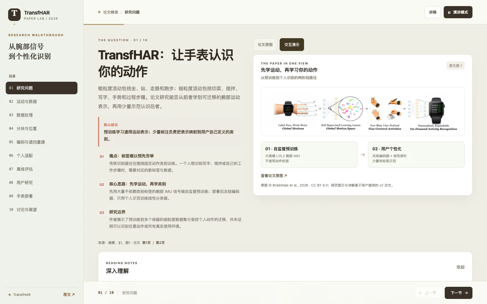
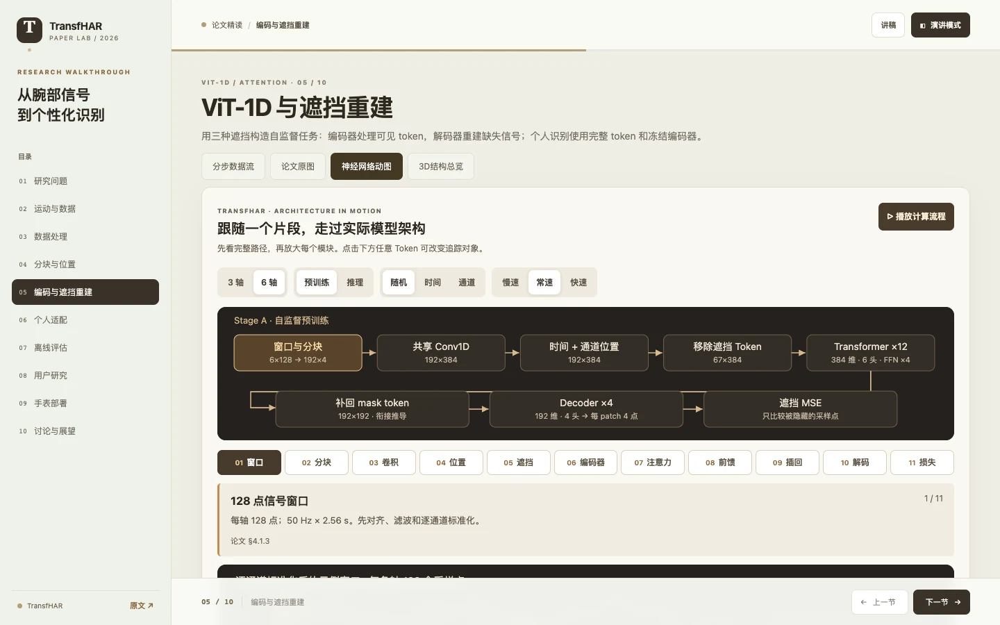

# TransfHAR Explorer

面向论文学习与组会分享的中文交互网页：把 TransfHAR 的论文原图、中文译注、分步数据流、神经网络动图和三维结构放在同一页，配 10 章讲解与约 30 分钟讲稿。

## 快速开始

| 方式 | 操作 |
| --- | --- |
| 离线阅读 | 下载 [dist/transfhar-explorer.html](dist/transfhar-explorer.html)，双击即可在浏览器中打开 |
| 本地开发 | `python3 -m http.server 8000`，访问 `http://localhost:8000` |
| 运行测试 | `npm test` |
| 重新构建 | `npm run build`（输出到 `dist/`） |

页面本身无需安装依赖；运行测试需要 Node.js 18+，构建与资源脚本需要 Python 3。

## 功能

- **四种视图**：模型章节可在分步数据流、论文原图、神经网络动图和 3D 结构总览之间切换。
- **原文对照**：内置 16 页论文截图与逐页中文译注，可与交互演示并排阅读。
- **可交互讲解**：窗口与重叠、遮挡模式、类别数、训练窗口数等参数都可以现场调整。
- **组会模式**：每章附讲稿与演讲模式，支持上一节/下一节、阅读进度和快捷键。
- **离线单文件**：图片、字体、KaTeX 与 Three.js 全部内联，方便拷贝和分享。
- **响应式**：桌面、平板和手机均可阅读。

## 界面

| 初始主界面 | 神经网络动图 |
| --- | --- |
| [](docs/screenshots/home.webp) | [](docs/screenshots/neural-motion.webp) |

神经网络动图跟随一个 token 走过分块、位置编码、遮挡、12 层编码器与解码 / 分类路径，可播放、逐步前进，并切换 3 轴 / 6 轴与预训练 / 推理。

## 项目结构

```text
transfhar-explorer/
├── index.html                 # 页面入口
├── src/
│   ├── css/style.css          # 样式
│   ├── js/                    # 交互、分步数据流、动图、Three.js 视图
│   └── data/                  # 课程内容与论文中文译注
├── assets/                    # 论文 PDF、原图、16 页原文截图
├── vendor/                    # Three.js、KaTeX 及许可证
├── tests/                     # 遮罩、形状与视图逻辑测试
├── tools/                     # 离线单文件构建、论文页与 KaTeX 资源生成
├── docs/                      # 讲稿、核查记录与 README 截图
└── dist/                      # 构建产物（单文件离线版）
```

## 资产与构建

- `assets/figures/` 与 `assets/pages/` 是页面直接使用的 WebP；`assets/paper.pdf` 保留论文原文件用于核对。
- `python3 tools/build_assets.py pages` 从 PDF 重新渲染原文页（需要 Pillow 与 Poppler）。
- `python3 tools/build_assets.py katex` 重新生成精简的 KaTeX 样式与字体。
- `python3 tools/build_offline.py` 生成 `dist/transfhar-explorer.html`；`npm run build` 是同一命令的快捷方式。
- 第三方依赖的版本与重新打包方式见 [vendor/README.md](vendor/README.md)。

## 内容边界

模型动画使用合成信号与示例权重，不含已训练模型、真实预测或注意力权重。中文对照是逐页译文和译注，不是逐词全文翻译。图表数值均来自论文作者报告，网页没有重新训练或复现实验。详细依据与限制见 [VERIFICATION.md](docs/VERIFICATION.md)；审查提示见 [REVIEW_NOTES.md](docs/REVIEW_NOTES.md)；独立讲稿见 [TransfHAR_30min_Speaker_Notes.md](docs/TransfHAR_30min_Speaker_Notes.md)。

## 论文与许可

### 引用

以下引用与论文首页的 **ACM Reference Format** 一致：

```text
Aidan Bradshaw, Riku Arakawa, Xin Liu, and Karan Ahuja. 2026. TransfHAR:
Self-Supervised Wrist Representations for On-Demand Activity Recognition.
In The 39th Annual ACM Symposium on User Interface Software and Technology
(UIST ’26), November 02–05, 2026, Detroit, MI, USA. ACM, New York, NY, USA,
16 pages. https://doi.org/10.1145/3830398.3830553
```

- DOI：[10.1145/3830398.3830553](https://doi.org/10.1145/3830398.3830553)
- 开放获取版本：[arXiv:2608.15861v2](https://arxiv.org/abs/2608.15861)

### 许可

- 论文与图片：[CC BY 4.0](https://creativecommons.org/licenses/by/4.0/)。论文首页版权声明为 © 2026 Copyright held by the owner/author(s)，ACM ISBN 979-8-4007-2856-3/2026/11。
- 本项目原创代码：[MIT](LICENSE)。
- `vendor/` 中的 Three.js、KaTeX 等第三方依赖遵循各自许可，详见 [vendor/README.md](vendor/README.md)。
